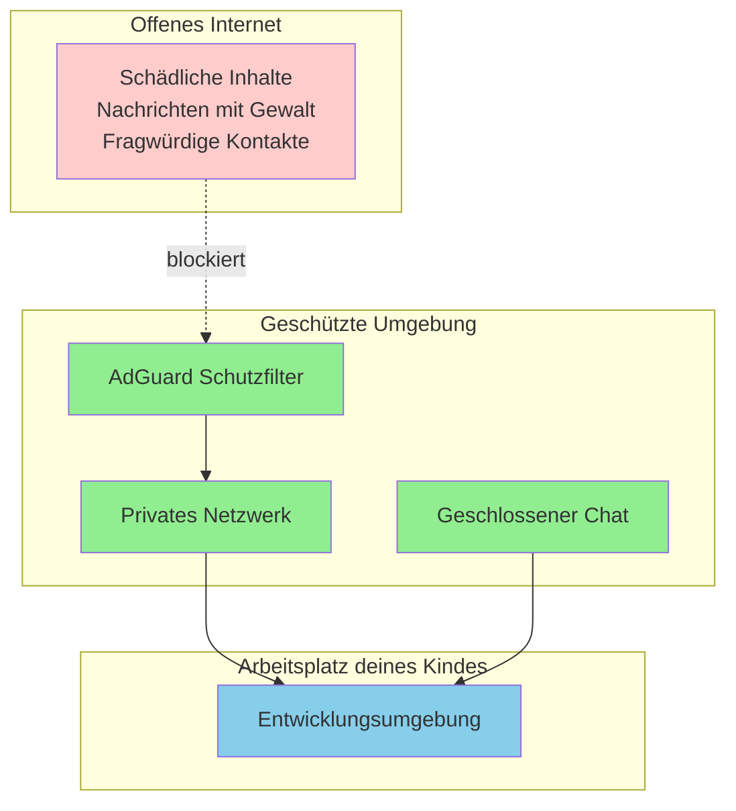
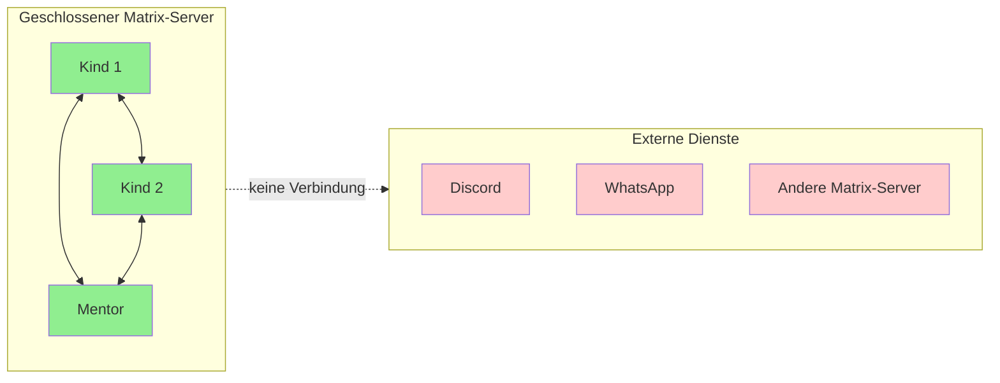

# Sicherheit der Entwicklungsumgebung

Als Elternteil möchtest du wissen, dass dein Kind in einer sicheren Umgebung arbeitet. Diese Seite erklärt, wie die technische Infrastruktur aufgebaut ist und warum sie besonders sicher für Kinder ist.

## Das Grundprinzip: Eine geschützte Blase

Die Entwicklungsumgebung deines Kindes ist bewusst vom "offenen Internet" abgeschirmt. Stell dir das wie einen geschützten Spielplatz vor: Dein Kind kann frei experimentieren und lernen, aber ungeeignete Inhalte und Kontakte von außen werden ferngehalten.

## Die drei Schutzebenen

### 1. Privates Netzwerk (Tailscale)

Der Rechner deines Kindes ist Teil eines privaten Netzwerks, das vollständig von mir kontrolliert wird. Das bedeutet:

- **Kein direkter Zugang aus dem Internet** – Der Rechner ist nicht öffentlich erreichbar
- **Nur autorisierte Geräte** – Nur Geräte, die ich explizit freigebe, können Teil des Netzwerks sein
- **Verschlüsselte Verbindungen** – Alle Daten werden verschlüsselt übertragen

### 2. Inhaltsfilter (AdGuard)

Der gesamte Internetverkehr läuft über einen Schutzfilter, der problematische Inhalte blockiert:

- **Schädliche Webseiten** – Malware, Phishing und andere Gefahren werden blockiert
- **Ungeeignete Inhalte** – Seiten mit nicht kindgerechten Inhalten werden gefiltert
- **Nachrichtenseiten** – Seiten mit verstörenden Meldungen über Gewalt, Krieg oder Katastrophen sind gesperrt
- **Die meisten Seiten bleiben erreichbar** – Nur problematische Inhalte werden blockiert, nicht das Internet als Ganzes

:::info Warum Nachrichtenseiten?
Nachrichtenseiten zeigen oft brutale Bilder und Berichte über Gewalt, Krieg und Katastrophen. Das ist für Erwachsene belastend – für Kinder kann es verstörend sein. Im Mentoring geht es ums Programmieren, nicht um aktuelle Nachrichten.
:::

### 3. Geschlossene Kommunikation (Matrix/Element)

Für die Kommunikation nutzen wir einen eigenen Chat-Server (kids.tinkerers.de):

- **Keine Fremden** – Der Server ist geschlossen, es gibt keine Verbindung zu anderen Chat-Netzwerken
- **Nur bekannte Teilnehmer** – Accounts werden nur auf Anfrage erstellt
- **Volle Funktionalität** – Gruppenchats, Videotelefonie und Bildschirmfreigabe funktionieren
- **Kein Abdriften** – Anders als bei Discord, WhatsApp oder Slack gibt es keine Ablenkung durch fremde Server oder Kanäle

## Remote-Support

Ich habe jederzeit die Möglichkeit, auf den Rechner deines Kindes zuzugreifen – aber nur über das geschützte Netzwerk:

- **Schnelle Hilfe** – Wenn dein Kind nicht weiterkommt, kann ich direkt helfen
- **Bildschirmfreigabe** – Ich sehe genau das gleiche wie dein Kind und kann Probleme live lösen
- **Keine Fremdzugriffe** – Nur ich habe diesen Zugang, niemand sonst

:::tip Transparenz
Der Remote-Zugang ist kein verstecktes Feature – dein Kind weiß davon. Es ist ein Werkzeug, um schnell und effektiv zu helfen, wenn etwas nicht funktioniert.
:::

## Verschiedene Hardware-Optionen

Je nach Situation nutzen wir unterschiedliche Hardware, aber alle Geräte sind identisch abgesichert:

| Option | Beschreibung | Sicherheit |
|--------|--------------|------------|
| Mini-PC | Kleiner, leiser Computer | Vollständig ins Schutznetzwerk eingebunden |
| Raspberry Pi | Günstiger Einplatinencomputer | Vollständig ins Schutznetzwerk eingebunden |
| Cloud-Server | Virtueller Server bei Hetzner | Vollständig ins Schutznetzwerk eingebunden |

Egal welche Option gewählt wird – die Sicherheitsmaßnahmen sind überall die gleichen.

## Updates und Wartung

Die Systeme werden automatisch aktuell gehalten:

- **Automatische Sicherheitsupdates** – Das Betriebssystem (Linux) aktualisiert sich selbstständig
- **Keine manuelle Wartung nötig** – Du musst dich um nichts kümmern
- **Bei Problemen greife ich ein** – Falls doch etwas schiefgeht, kümmere ich mich darum

## Zusammenfassung

Die Entwicklungsumgebung deines Kindes ist so aufgebaut, dass:

1. **Kein ungeeigneter Inhalt** durchkommt (Inhaltsfilter)
2. **Keine fremden Personen** Kontakt aufnehmen können (geschlossener Chat)
3. **Schnelle Hilfe** bei technischen Problemen möglich ist (Remote-Support)
4. **Alles verschlüsselt** und privat bleibt (privates Netzwerk)

Dein Kind kann sich voll aufs Programmieren konzentrieren – in einer Umgebung, die so sicher wie möglich ist.
