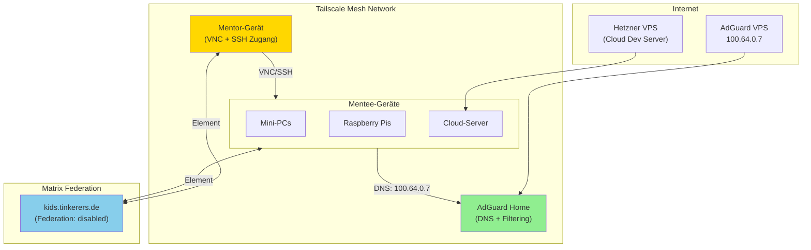
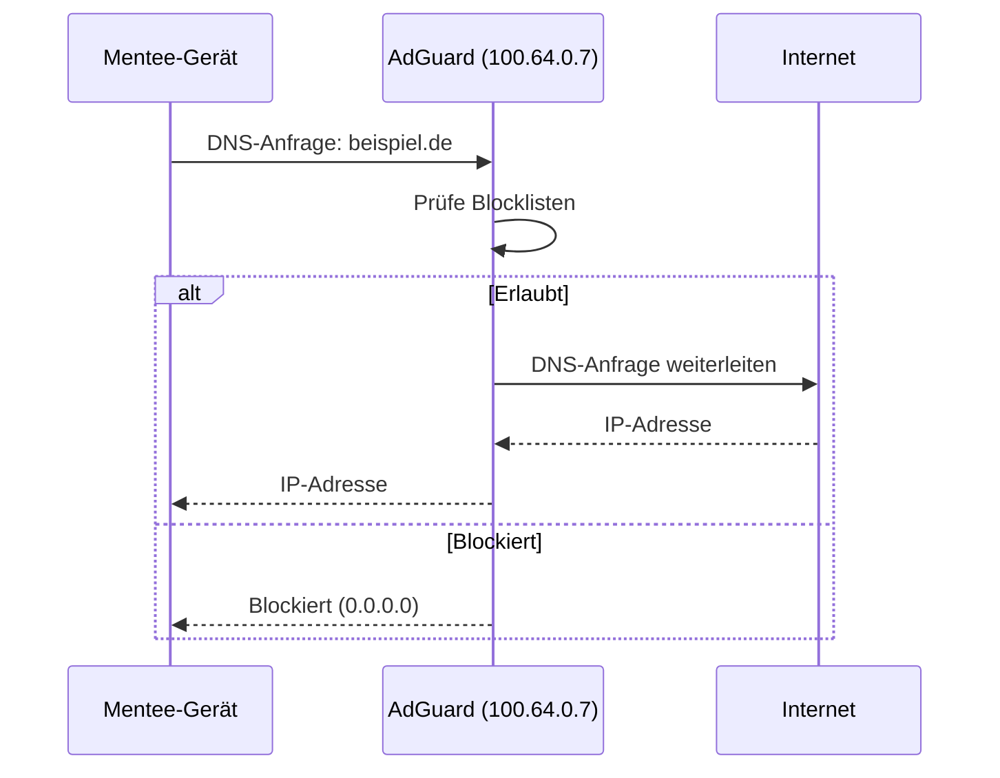
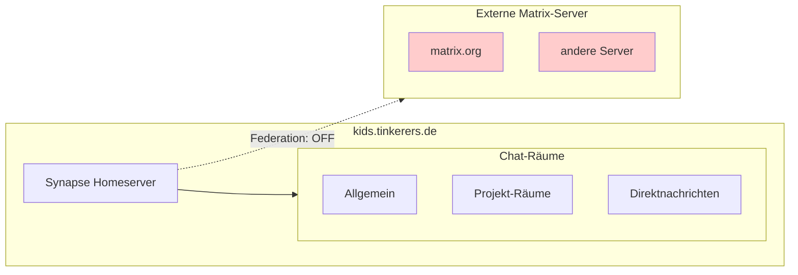
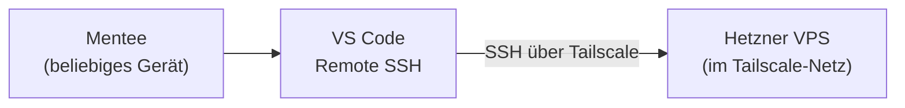
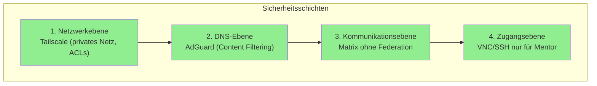

# Entwicklungsinfrastruktur

Diese Seite dokumentiert das technische Setup der Entwicklungsumgebungen für die Mentees. Das Setup ist darauf ausgelegt, Kindern eine sichere, abgeschirmte Arbeitsumgebung zu bieten.

## Architekturübersicht



## Komponenten im Detail

### Tailscale Mesh Network

Alle Geräte sind Teil eines privaten Tailscale-Netzwerks. Das ermöglicht:

- **Privates Netzwerk ohne Port-Forwarding** – Geräte sind nicht öffentlich erreichbar
- **Ende-zu-Ende-Verschlüsselung** – WireGuard-basiert
- **NAT-Traversal** – Funktioniert auch hinter restriktiven Firewalls
- **ACLs** – Zugriffsregeln definieren, wer mit wem kommunizieren darf

#### ACL-Konfiguration

Die Kinder brauchen in der Regel keinen Zugriff untereinander. Eine typische ACL-Struktur:

```json
{
  "acls": [
    {
      "action": "accept",
      "src": ["tag:mentor"],
      "dst": ["tag:mentee:*"]
    },
    {
      "action": "accept",
      "src": ["tag:mentee"],
      "dst": ["tag:adguard:53"]
    }
  ]
}
```

:::note Flexibilität
Falls für bestimmte Projekte Peer-to-Peer-Zugriff zwischen Mentees sinnvoll ist (z.B. gemeinsame Entwicklung), lässt sich das über die ACLs temporär freischalten.
:::

### AdGuard Home

AdGuard Home läuft auf einem dedizierten VPS im Tailscale-Netzwerk und dient als DNS-Server für alle Mentee-Geräte.

**Konfiguration auf den Mentee-Geräten:**
```bash
# /etc/resolv.conf oder via systemd-resolved
nameserver 100.64.0.7
```

**Blockierte Kategorien:**
- Malware und Phishing
- Tracking und Werbung
- Nachrichtenseiten (verstörende Inhalte über Gewalt/Krieg)
- Nicht kindgerechte Inhalte

**SSL-Zertifikate:** AdGuard läuft mit gültigen SSL-Zertifikaten für DNS-over-HTTPS/TLS.



### VNC + SSH Zugang

Auf jedem Mentee-Gerät läuft ein VNC-Server, der nur über die Tailscale-IP erreichbar ist:

- **Zweck:** Remote-Support und Troubleshooting
- **Zugang:** Nur über Tailscale, nicht aus dem offenen Internet
- **Zusätzlich:** Root-Account und SSH-Zugang auf allen Geräten

```bash
# Beispiel: Verbindung zu einem Mentee-Gerät
ssh root@100.64.0.X
# oder
vncviewer 100.64.0.X:5900
```

### Matrix-Server (kids.tinkerers.de)

Ein dedizierter Matrix-Server ohne Federation:



**Warum keine Federation:**
- Kinder können nur mit bekannten Personen kommunizieren
- Keine Kontaktaufnahme durch Fremde möglich
- Kein "Abdriften" in öffentliche Räume anderer Server

**Account-Erstellung:**
- Registrierungstoken-basiert
- Accounts werden individuell erstellt
- Kein Self-Service (bewusste Entscheidung)

**Features:**
- Gruppenchats
- Direktnachrichten
- Videotelefonie
- Bildschirmfreigabe (Screen Sharing)

## Hardware-Varianten

### Mini-PCs

Physische Geräte, die bei den Mentees zu Hause stehen:
- Manuelle Ersteinrichtung
- Tailscale-Client installiert
- VNC-Server konfiguriert

### Raspberry Pi

Kostengünstige Alternative:
- Gleiches Setup wie Mini-PCs
- Etwas weniger Leistung, aber für die meisten Projekte ausreichend

### Cloud-Server (Hetzner VPS)

Für Mentees ohne eigene Hardware oder mit unzuverlässiger Internetverbindung:



**Cloud-Init-Automatisierung:**

Die Cloud-Server werden mit Cloud-Init-Skripten provisioniert:

```yaml
#cloud-config
packages:
  - git
  - vim
  - build-essential

runcmd:
  - # Tailscale-Setup (derzeit manuell)
  - # VNC-Server-Setup
```

:::tip Automatisierung
Das Tailscale-Setup erfolgt derzeit manuell. Eine Automatisierung über Cloud-Init mit Auth-Keys ist geplant:
```bash
curl -fsSL https://tailscale.com/install.sh | sh
tailscale up --authkey=tskey-auth-xxx
```
:::

## Sicherheitskonzept



| Bedrohung | Schutzmaßnahme |
|-----------|----------------|
| Direkter Angriff aus dem Internet | Tailscale (keine öffentliche IP) |
| Schädliche Webseiten | AdGuard Blocklisten |
| Ungeeignete Inhalte | AdGuard Content Filter |
| Kontakt mit Fremden | Matrix ohne Federation |
| Technische Probleme | VNC/SSH Remote-Zugang |

## Updates und Wartung

**Automatische Updates:**
- `unattended-upgrades` auf allen Linux-Systemen
- Sicherheitsupdates werden automatisch installiert

**Manuelle Eingriffe:**
- Bei Bedarf über SSH/VNC
- Größere Upgrades nach Absprache

## Einrichtung neuer Geräte

### Checkliste

1. **Betriebssystem installieren** (Linux)
2. **Tailscale installieren und einrichten**
   ```bash
   curl -fsSL https://tailscale.com/install.sh | sh
   tailscale up
   ```
3. **DNS auf AdGuard setzen** (100.64.0.7)
4. **VNC-Server installieren und konfigurieren**
5. **SSH-Zugang einrichten** (Root-Account)
6. **Element installieren** und Account auf kids.tinkerers.de erstellen
7. **Entwicklungstools installieren** (VS Code, Git, etc.)

### Cloud-Server (Hetzner)

1. **VPS erstellen** mit Cloud-Init-Skript
2. **Tailscale manuell einrichten** (Auth-Key)
3. **Rest wie oben**

## Weiterführende Ressourcen

- [Tailscale Documentation](https://tailscale.com/kb/)
- [AdGuard Home Wiki](https://github.com/AdguardTeam/AdGuardHome/wiki)
- [Matrix Synapse Admin Guide](https://element-hq.github.io/synapse/latest/)
