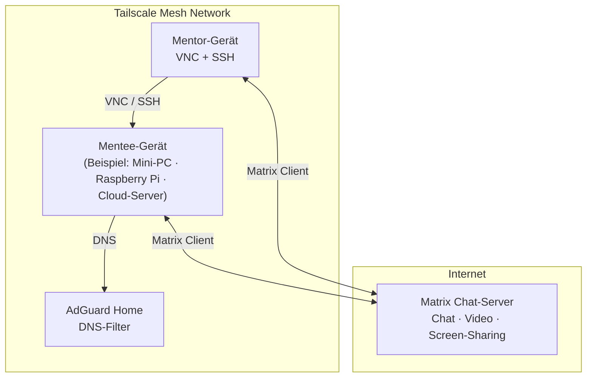

---

sidebar_position: 10

title: Entwicklungsinfrastruktur

---

## Zielsetzung

Die Infrastruktur verfolgt drei zentrale Ziele:

1. **Reduktion unnötiger Angriffsflächen** (kein unnötig offener Zugriff aus dem Internet)
2. **Minimierung von Versuchungen und Ablenkungen** für Mentees
3. **Gute Wart- und Unterstützbarkeit** für Mentor:innen

Absolute Sicherheit ist weder möglich noch Ziel dieser Architektur. Es handelt sich um ein bewusst gestaltetes **Best‑Effort‑Setup**, das Risiken reduziert, ohne falsche Sicherheitsannahmen zu erzeugen.

Wichtig ist dabei: Diese Seite soll **nicht belehren**, ob ein Setup „sicher genug“ ist. Sie versteht Infrastruktur als **Gestaltungswerkzeug**. Ziel ist es, Mentor:innen aufzuzeigen, welche Räume sich zwischen völliger Abschottung und ungefiltertem Internet eröffnen – und wie diese bewusst gestaltet werden können.

---

## Architekturübersicht

:::note Darstellung
Im Fokus steht jeweils **ein Mentee‑Gerät**. Ob es sich dabei um einen Mini‑PC, einen Raspberry Pi oder einen Cloud‑Server handelt, ist für die Architektur nachrangig. Entscheidend ist, dass dieses Gerät Teil des Tailscale‑Mesh‑Netzwerks ist.

AdGuard Home läuft ebenfalls innerhalb dieses Netzes. Er muss nicht auf dedizierter Hardware betrieben werden, sondern auf irgendeinem System, das im Tailscale‑Netzwerk erreichbar ist und ausschließlich dort DNS‑Anfragen entgegennimmt.
:::

---

## Zentrale Komponenten

### Tailscale

Tailscale wird **nicht** als Schutz vor Inhalten verstanden, sondern ausschließlich als Werkzeug zur **Zugriffskontrolle und Administration**:

* kein Port‑Forwarding
* keine öffentlichen Management‑Interfaces
* gezielter administrativer Zugriff auf Mentee‑Systeme

Typische Einsatzfälle:

* SSH‑Zugriff durch Mentor:innen
* VNC/Remote‑Support
* Absicherung von Cloud‑Systemen gegen direkten Internetzugriff

---

### DNS‑Filtering (AdGuard Home)

AdGuard Home fungiert als zentraler DNS‑Resolver für alle Mentee‑Systeme.

* Filterung problematischer Domains
* Blockieren von Nachrichtenseiten
* Sperrung sozialer Netzwerke und Plattformen (z. B. Facebook, Reddit u. a.)
* Ausblenden bekannter Tracking‑ und Malware‑Domains

Wichtig: **Der Internetzugang bleibt grundsätzlich offen.**
Blockiert wird ausschließlich auf DNS‑Ebene.

:::info Warum kein öffentlicher DNS‑Dienst?
AdGuard bietet öffentliche „Safe DNS“-Server an, die bereits grundlegende Schutzfunktionen bereitstellen. Diese sind jedoch **nicht ausreichend konfigurierbar**:

* Nachrichtenseiten lassen sich dort nicht gezielt sperren
* zusätzliche Kategorien (soziale Netzwerke, Ablenkungsplattformen) können nicht differenziert gefiltert werden
* projektspezifische Anpassungen sind nicht möglich

Für die Mentoring‑Umgebung ist eine **feingranulare, anpassbare Filterung** erforderlich. Deshalb wird ein eigener AdGuard‑Home‑Server betrieben.
:::

:::note Warum AdGuard nicht öffentlich betrieben wird (Port 53)
In Rechenzentren ist der Betrieb öffentlicher DNS‑Server auf Port 53 häufig untersagt oder stark eingeschränkt. Offene DNS‑Resolver stellen ein erhebliches Missbrauchs‑ und DDoS‑Risiko dar und werden daher von vielen Providern blockiert oder reglementiert.

AdGuard Home wird deshalb **nicht öffentlich exponiert**, sondern ausschließlich innerhalb des Tailscale‑Mesh‑Netzwerks betrieben. So ist der Dienst nur für berechtigte Systeme erreichbar und nicht Teil der offenen DNS‑Infrastruktur des Internets.

Diese Entscheidung passt zudem gut zur Gesamtarchitektur, da alle Mentee‑Geräte ohnehin Teil des Tailscale‑Netzwerks sind.
:::

---

### Benutzer‑ und Systemrechte

Mentees arbeiten ohne Administrator‑Rechte:

* keine Installation eigener Software
* keine Änderung von Netzwerk‑ oder Sicherheitseinstellungen
* reduzierte Möglichkeit zur Umgehung von Schutzmaßnahmen

Diese Ebene dient primär der Stabilität und der Reduktion unbeabsichtigter Grenzüberschreitungen.

---

### Kommunikation (Matrix)

Die Kommunikation erfolgt über einen eigenen Matrix‑Chat‑Server mit:

* Gruppen‑Chats
* Direktnachrichten
* Videotelefonie
* Bildschirmfreigabe

Der Server ist aus dem Internet erreichbar, der Zugriff jedoch **authentifiziert und zugangsbeschränkt**. Er dient ausschließlich der Kommunikation im Mentoring‑Kontext und ist kein öffentlicher Chat‑Dienst.

---

## Cloud‑Systeme vs. Heimgeräte

Cloud‑Server unterscheiden sich technisch grundlegend von Heimcomputern:

* sie sind initial aus dem Internet erreichbar
* sie benötigen besondere Absicherung

Durch die Einbindung in Tailscale wird der Cloud‑Server:

* für das offene Internet unsichtbar
* ausschließlich über das private Netz administrierbar

Remote‑Zugriffe erfolgen – abhängig vom Kontext – entweder:

* über das VPN (bevorzugt)
* oder über abgesicherte Protokolle mit starken Passwörtern

---

## Remote‑Zugriff

Typische Werkzeuge:

* SSH (Administration)
* VNC (Support)
* VS Code Remote SSH

Grundsätze:

* kein direkter Root‑Zugriff für Mentees
* starke Passwörter / Keys
* Änderungen nachvollziehbar

---

## Automatisierung & Wartung

* automatische Sicherheitsupdates
* manuelle Updates bei größeren Änderungen
* Cloud‑Init für Basis‑Provisionierung

Vollautomatisierung ist **ein erklärtes Ziel**, aber technisch anspruchsvoll und derzeit nur teilweise umgesetzt.

:::note Stand der Automatisierung (Tailscale & Cloud‑Zugriff)
Die vollständige Automatisierung des Tailscale‑Beitritts ist aktuell noch nicht zufriedenstellend gelöst.

Insbesondere bei Cloud‑Systemen ergibt sich eine praktische Herausforderung:

* Um ein Cloud‑System sicher zu betreiben, sollte es **zunächst** Teil des Tailscale‑Netzwerks werden.
* Um Tailscale beitreten zu können, benötigen Nutzer:innen jedoch bereits **Zugriff auf das System**.

Dieser Henne‑Ei‑Effekt ist für technisch unerfahrene Nutzer:innen schwer aufzulösen. In der Praxis überfordert es viele, zunächst ein VPN einzurichten und erst danach eine Remote‑Desktop‑Verbindung aufzubauen.

Daher wird aktuell häufig ein pragmatischer Mittelweg gewählt:

* Der Remote‑Desktop‑Dienst (z. B. RDP/VNC) ist initial **nach außen erreichbar**.
* Der Zugriff wird durch **sehr starke Passwörter** abgesichert.
* Nach erfolgreichem Onboarding und Tailscale‑Beitritt kann dieser Zugriff weiter eingeschränkt oder ganz geschlossen werden.

Diese Lösung ist nicht ideal, aber realistisch und handhabbar. Sie stellt einen bewussten Kompromiss zwischen Sicherheit, Nutzbarkeit und organisatorischem Aufwand dar.
:::

---

## Gestaltung statt Belehrung

In der Praxis erleben viele Kinder digitale Umgebungen entweder als stark eingeschränkt (kein Internet, reine Übungsaufgaben) oder als vollständig unkontrolliert („freies Internet, lerne schwimmen“).

Diese Infrastruktur zeigt einen **dritten Weg**:

* Internetzugang ist vorhanden
* aber bewusst strukturiert
* mit klar gestalteten Kommunikations‑ und Arbeitsräumen

Mentor:innen übernehmen hier eine **gestaltende Rolle**. Sie entscheiden nicht nur *ob* Kinder Zugang zum Internet haben, sondern *wie* dieser Zugang aussieht.

Das betrifft sowohl Inhalte als auch Kommunikation.

### Inhalte als gestaltbarer Raum

Nicht jede Plattform stellt für Kinder das gleiche Risiko dar. Während Dienste wie soziale Netzwerke oder Video‑Plattformen stark auf Aufmerksamkeit, Empfehlung und Eskalation ausgelegt sind, existieren andere Angebote, die funktional, zielgerichtet und arbeitsbezogen sind.

Beispiel:

* **GitHub** ist in dieser Umgebung grundsätzlich erlaubt, da es für die Arbeit notwendig ist und kein typisches „Abdriften“ begünstigt.
* Gleichzeitig bleibt es eine bewusste Entscheidung. Denkbar wäre auch ein späterer Übergang zu einer eigenen GitLab‑Instanz oder strengeren Einschränkungen.

Entscheidend ist nicht die perfekte Liste erlaubter Seiten, sondern das **bewusste Abwägen**.

### Kommunikation als gestaltbarer Raum

Ähnliches gilt für persönliche Kommunikation. Gängige Messenger‑Dienste sind für Erwachsene konzipiert und setzen Telefonnummern, offene Kontaktstrukturen und externe Reichweite voraus.

Für Kinder entstehen dadurch unnötige Risiken.

Durch eine eigene Kommunikationsinfrastruktur (z. B. Matrix) lassen sich Alternativen schaffen:

* Kommunikation nur mit bekannten Personen
* klare Zugehörigkeit (z. B. Schul‑ oder Projektkontext)
* keine externen Kontaktaufnahmen

So entstehen Kommunikationsräume, die **Austausch ermöglichen**, ohne Kinder ungeschützt in erwachsene Plattform‑Ökosysteme zu schicken.

Diese Seite soll Mentor:innen ermutigen, Infrastruktur nicht als gegeben hinzunehmen, sondern als **pädagogisches Gestaltungsmittel** zu verstehen.

---

## Sicherheitsverständnis und Grenzen

Diese Infrastruktur ist:

* kein Hochsicherheits‑System
* kein Ersatz für pädagogische Begleitung

Sie ist ein **technisch sauberer, wartbarer Rahmen**, der Mentoring ermöglicht, ohne unnötige Risiken zu erzeugen.
